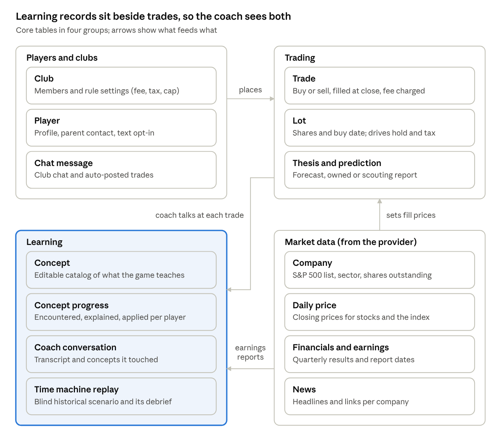

# Owners Club — Build Spec

Jeff Keltner · last updated Oct 18, 2026

This is the build-facing companion to [the product concept](concept.md). The concept doc holds the product rules and the reasoning reviewers see; this doc holds the technical decisions, the data model and anything the code needs. When the two disagree, the concept doc wins on game rules and this doc wins on implementation.

## Decision log

Every technical decision lands here with its status. Product and game-rule decisions live in the concept doc.

| Area | Decision | Why | Status |
| --- | --- | --- | --- |
| Name | Owners Club. Folder owners\_club, repository owners-club. | Signals the ownership mindset the game teaches; each friend group is its own named club. | Decided |
| Platform | A mobile-optimized web app that kids add to their home screen. No native app for the pilot. | Chat works fine in a browser, iPhones support push for home-screen web apps since iOS 16.4, and there's no app store review. Go native later only if the pilot shows kids keep coming back; the backend carries over. | Decided |
| Notifications | Text (Twilio) and email are the main channels; web push is a bonus. | Reaches kids with nothing to install. Texting needs A2P 10DLC registration (Twilio's Sole Proprietor option fits a pilot) and a parent's opt-in for each phone number. | Decided |
| Audience | Ages 13 and up, private leagues by invitation only. | Keeps the pilot outside COPPA's parental-consent rules for under-13s; reviewers also felt younger kids may be too young. | Decided |
| Open source | Public repository under the MIT license. API keys, credentials and all player data stay out of the code, in environment settings and the database. | Lets teachers and parents reuse it and reviewers suggest better teaching notes, and qualifies for Alpha Vantage's open-source and educational access. Anyone running their own copy needs their own market data license; the README will say so. Public code means access rules (each kid sees only their own league) must be right from day one. | Decided |
| Learning objectives | Stored as structured, editable records that the coach, weekly recap and progress tracker all read. | One source of truth for what the game teaches and how. See [Learning objectives store](#learning-objectives-store); the catalog itself lives in [`content/concepts.yaml`](../content/concepts.yaml). | Decided |
| Game settings | Fee, tax rates, hold period and position cap are per-league settings, with defaults from the concept doc. | Lets us tune the rules during the pilot without code changes. | Decided |
| Trade execution | Orders fill at the next market close. Portfolios and the leaderboard update once a day, after the close. | Needs only end-of-day prices (cheaper, simpler licensing) and removes any reason to watch prices during the day. One daily update is plenty for long-term play and less distracting. | Decided |
| Backend | A hosted Postgres database with built-in login and real-time chat (Supabase or similar), and a web framework on a managed host. | The smallest setup that covers accounts, trades and chat. | Proposed |
| AI model | Claude API for the coach, the weekly recap and the concept tagger. | Strong at Socratic questioning and plain-language writing; one vendor for all three jobs. | Proposed |
| Market data | A free stack behind our own data layer: SEC EDGAR for fundamentals, Massive's free tier for daily prices, Alpha Vantage's free tier for earnings dates, news and time-machine history. Before beta, get written display permission for prices (Alpha Vantage first; Intrinio Startup as the known-price fallback). About 5 to 30 calls a day in total. | See Market data. | Decided |
| Time machine data | Replays need about 25 years of daily prices plus historical financials for the companies in each scenario, precomputed and stored. | Confirm how far back Alpha Vantage's daily history goes. Structured financials from SEC EDGAR start around 2009, so a 2000 dot-com valuation replay needs another source or hand-entered figures. | Open |
| Feedback loop | Once the docs move to the GitHub repo: an in-app feedback button files GitHub issues, and a scheduled Claude task reviews new issues weekly, groups them and proposes a plan for review before anything is built. | Keeps player and reviewer feedback in one place next to the code, and automates the design feedback loop while keeping a human approval step. | Proposed |
| App home screen | Returning players with a portfolio open on the feed; players still onboarding resume where they left off. | The feed is what changed since last time; the other tabs are a tap away. | Decided |
| Prototype hosting | The prototype goes on Vercel as a public static site (no password), with one serverless function that files feedback notes as GitHub issues. | Lets outside playtesters try it from a link; the GitHub token stays on the server. | Decided |
| Starting position | Every player starts with $10,000 in an S&P 500 index holding. It's exempt from the 25% cap and the minimum hold, and pays the same fees and taxes as any other holding. | Removes the blank-portfolio problem for first-timers. No hold lets money move into a first pick right away; equal taxes keep the index from becoming a tax shelter. The data layer needs index prices (an S&P 500 ETF's daily close works). | Decided |
| Design iteration | Clickable prototypes of the six key screens (onboarding, coach, portfolio, sell-now, leaderboard, time machine), playtested with a few kids before the full build. | Whether kids find it fun decides whether any of the learning happens, and screens are far cheaper to change as prototypes than as code. | Proposed |
| Prototype stack | Vite + React + TypeScript in `prototype/`, building to static files. Content YAML imported at build time; fake data in `prototype/src/data/`; state in localStorage. | The brief's default. No backend, so it can be hosted on GitHub Pages and opened on a phone from a link. | Decided |
| Coach interface | One async function, `askCoach(context, input)`, returns chat bubbles, tap replies and concept marks. The prototype's version is scripted; the real one calls the Claude API with the same inputs. | Lets the live coach replace the script without touching any screen. | Proposed |
| Lesson content | Lessons live in `content/lessons.yaml`: round 1 (example and predict question) and round 3 (the coach's question, push back and wrap-up) as editable text with `{placeholders}`; round 2 is interactive and computed from game numbers, so it lives in code, one component per format. | Writers and reviewers can edit lesson wording without touching code, while the interactive parts stay testable. Round 3 runs through `askCoach` in a `lesson` mode, so the live coach can take it over. | Proposed |
| Time machine replays | Each replay is one record in `prototype/src/data/time_machine.ts`: the price series, checkpoints, allowed choices (hold, trim, sell, buy back), comparison runs and the coach's debrief lines computed from the results. The same component runs a replay on its own or as round 2 of a lesson. | Adding a replay means adding data, not a screen. In the real app the series come from stored history (see the Time machine data row). | Proposed |
| Index-to-pick fee | Moving money from the index into a pick is one trade: one 0.5% fee on the amount moved, not a fee on the index sale plus another on the purchase. | Keeps the first pick simple to explain; rule recorded in the concept doc's index holding section. | Decided |

## Data model

The database needs three kinds of records the app owns (players, trades and learning) plus a cache of market data from the provider.

Two details matter most for the game rules. Each purchase is stored as its own lot with a buy date, which is what makes the hold period, the 6-month tax threshold and losses offsetting gains computable. And each coach conversation links to both the trade or thesis that prompted it and the concepts it touched, so the tracker can always show its evidence.

A scouting report is a thesis with no position attached, so it's scored at earnings the same way. Ranks (Shareholder, Owner, Board Member, Chair) and the Bell are computed from these records rather than stored separately.

## Learning objectives store

The concept list is data, not code. Each concept is an editable record, and every AI part of the app reads from the same records, so adding a concept or changing how it's taught changes the coach, the recap and the tracker at once.

**Each concept record holds:**

| Field | What it holds | Example: P/E ratio |
| --- | --- | --- |
| Slug | A stable id | pe-ratio |
| Level | 1 to 3 | 1 |
| Prerequisites | Concepts a player should have applied first | market-cap, revenue-vs-earnings |
| Learned by | Explanation or experience | Explanation |
| Kid explanation | Two or three sentences a 13-year-old understands | How many dollars investors pay today for each $1 the company earns in a year. |
| Teaching notes | How we want it presented: analogies to use, things to avoid | Use a lemonade-stand example. Never call a high P/E "bad"; ask what growth would justify it. |
| Misconceptions | Wrong ideas to watch for | "A low P/E means the stock is cheap." |
| Trigger events | Game events that mark it as encountered | Buying a stock with a P/E over 50 |
| Coach questions | Questions the coach can ask around it | What would earnings need to do for this price to make sense? |
| Check questions | Multiple-choice questions with answers | Two companies trade at 30x earnings; one grows 10% a year, one 40%. Which is the better deal? |
| Status | Draft or active | Active |

**Each player's progress** is a separate record per player and concept: when it was encountered, explained and applied, with a link to the evidence (the coach conversation, thesis or game event).

**How the AI parts use it:**

- **Coach:** every conversation gets a one-line summary of each active concept, the full record for the one to three concepts this moment touches (picked by trigger events and the player's progress), and the player's progress record. So it knows what's covered, what's next, and how we want each idea taught.
- **Weekly recap:** picks one concept that most of the league hasn't encountered and works it into the recap.
- **Concept tagger:** after each coach conversation or new thesis, a small model call marks which concepts were encountered, explained or applied, and saves the evidence.

**No search index needed yet.** At 10 to 50 concepts, the whole catalog fits easily in the coach's context, so the app selects concepts by rules rather than by similarity search. That's simpler to build and easier to predict. A retrieval layer becomes worthwhile only if the library grows to hundreds of concepts or long teaching materials.

**Editing:** start with the catalog as a structured file in the code repository that loads into the database on each deploy, so Claude Code can edit it and changes are versioned. Add an admin page later if reviewers want to edit concepts directly.

**Ranks.** A player's rank is computed from their progress records: Owner when every active Level 1 concept is applied, Board Member for Level 2, Chair for Level 3 plus a full season of scored predictions. The thresholds live in the same catalog file, so they can be tuned without code changes.

**Quizzes teach; theses prove.** A passed check question sets a concept to explained only. The tagger sets applied only from a thesis or scouting report, so players can speed-run learning but can't quiz their way up the ranks.

**Time machine scenarios** are records in the same catalog:

| Field | What it holds |
| --- | --- |
| Concepts | Which concepts the replay teaches |
| Real setup | The actual tickers, weights and date range |
| Blind description | What the player sees, with no company name or date |
| Checkpoints | The moments the player chooses to hold, trim or sell |
| Reveal | The company, the dates and what actually happened |
| Debrief questions | What the coach asks afterward |

Each scenario's prices are precomputed and stored, so a replay never calls the market data provider.

## Market data

The data itself is cheap; the right to show it to kids in an app is the hard part. Every affordable plan I found is licensed for personal or internal use only. Showing the data to other people needs a separate display agreement, priced by quote. FMP says this applies even to a free, private prototype with a handful of users.

**What the game needs:** the S&P 500 list; daily closing prices for each stock and the index; quarterly financials (revenue, net income, EPS, shares outstanding) to compute P/E, margins and growth; an earnings calendar with actual results; and company news headlines. The full running list, with what each number is used for, is in [data needs](data_needs.md).

| Provider | What it covers | Individual price | Showing data to app users |
| --- | --- | --- | --- |
| [Alpha Vantage](https://www.alphavantage.co/support/#support) | Prices, fundamentals (including P/E and earnings vs. estimates), earnings calendar, news | Free at 25 requests a day; [premium](https://www.alphavantage.co/premium/) from $49.99/mo; "unlimited API requests for verified open-source or educational projects" | [Terms](https://www.alphavantage.co/terms_of_service/) license personal, non-commercial use, and count letting anyone else access the data as commercial. The educational offer lifts request limits; it doesn't say it grants display rights |
| [Financial Modeling Prep (FMP)](https://site.financialmodelingprep.com/pricing-plans) | Prices, fundamentals, earnings calendar and news in one API | $19/mo (Starter) to $49/mo (Premium), billed annually | Needs a separate Data Display and Licensing Agreement, priced by quote ([FMP guidance](https://site.financialmodelingprep.com/insights/platform/can-you-use-fmp-data-in-a-public-app-website-or-client-dashboard)) |
| [EODHD](https://eodhd.com/pricing) | Prices, fundamentals, earnings calendar, news | $49.99/mo (fundamentals) or $83.33/mo (all-in-one), billed annually | Cheapest [commercial plan](https://eodhd.com/commercial-pricing) is $399/mo and internal-use only; display by custom quote |
| [Tiingo](https://www.tiingo.com/about/pricing) | Prices and news; fundamentals as an add-on | $30/mo; business internal use $50/mo | Internal use only; redistribution through sales |
| [Massive (formerly Polygon)](https://massive.com/pricing) | The strongest price data; financials as an add-on | $29 to $199/mo | [Business plan](https://massive.com/business) $2,499/mo, financials add-on $699/mo; startups can get 25%+ off the first year |
| [SEC EDGAR](https://www.sec.gov/search-filings/edgar-application-programming-interfaces) | Official financials straight from company filings | Free, no key needed | Public government data. No prices, news or estimates, and the raw data needs cleanup |

**Decision:** start on a free stack, with every source behind our own data layer so any piece can be swapped.

| Data | Source | Calls | Notes |
| --- | --- | --- | --- |
| Fundamentals (revenue, earnings, EPS, shares) | [SEC EDGAR](https://www.sec.gov/search-filings/edgar-application-programming-interfaces) bulk download | 0: one nightly file covers every company | Public filings, so showing them to players needs no license. Structured data starts around 2009. |
| Daily closing prices, all US stocks | [Massive free tier](https://massive.com/docs/rest/stocks/aggregates/daily-market-summary) whole-market daily summary | 1 a day | Free tier keeps 2 years of history and is licensed for individual use. |
| Earnings dates and results, news headlines | Alpha Vantage free tier | A handful a day | 25 requests a day. News is shown as headlines that link out. |
| Long price history for time-machine scenarios | Alpha Vantage full daily history | A few dozen, once per scenario | Fetched once and stored with each scenario. |

**How the data layer works:**

- **A thin adapter per data type.** Prices, financials, earnings and news each have one module, so swapping a source changes one module and nothing else.
- **The app never calls a provider directly.** A nightly job pulls everything into our own tables, and every screen, the coach and the leaderboard read only from those tables.
- **We compute the numbers ourselves.** P/E, margins and growth come from raw financials in our code, so they don't depend on any provider's definitions.
- **Development stays inside the free terms,** which allow personal use for research and testing.

**What still needs a license before beta: daily closing prices.** Stock exchanges own price data, so displaying it to players is the one piece the free tiers don't cover. Fundamentals come from public filings and news links out, so neither needs a display license. Before any kid sees the app, ask Alpha Vantage for written permission under its educational access. If they say no, [Intrinio's Startup plan](https://intrinio.com/pricing) includes display rights at a published price ($333/mo for the first 6 months, then $666 and $999), and only the price adapter changes.

I'm not a lawyer; the display terms need to be confirmed in writing with whichever provider we choose.

## Open technical questions

- [ ] Before beta: will Alpha Vantage confirm in writing that its educational access covers showing daily prices to players? If not, is Intrinio Startup worth it, or is there a cheaper licensed price source?
- [ ] Sector yardsticks: which can we compute from SEC filings (free cash flow, margins, return on equity, price-to-book, Rule of 40), and which company-reported numbers (same-store sales, subscribers, customer retention) do we skip for the alpha or source elsewhere? Each company also needs a sector tag to pick its lens.
- [ ] Dividends: credit them to portfolios as cash and measure against the S&P 500's total return, including dividends. Needs dividend history from the price source.
- [ ] Does an AI recap that summarizes licensed news count as displaying that news?
- [ ] Who edits the concept catalog: only through Claude Code, or do reviewers need an admin page?
- [ ] How do accounts work: does a parent create the account and invite the kid, and do kids log in by email link or by phone?
- [ ] How long do we keep kids' chat messages and coach conversations?

## Sources

- [OneSignal: web push for iOS](https://documentation.onesignal.com/docs/web-push-for-ios)
- [Twilio: A2P 10DLC registration](https://www.twilio.com/docs/messaging/compliance/a2p-10dlc)
- Provider pricing pages are linked in the Market data table.
