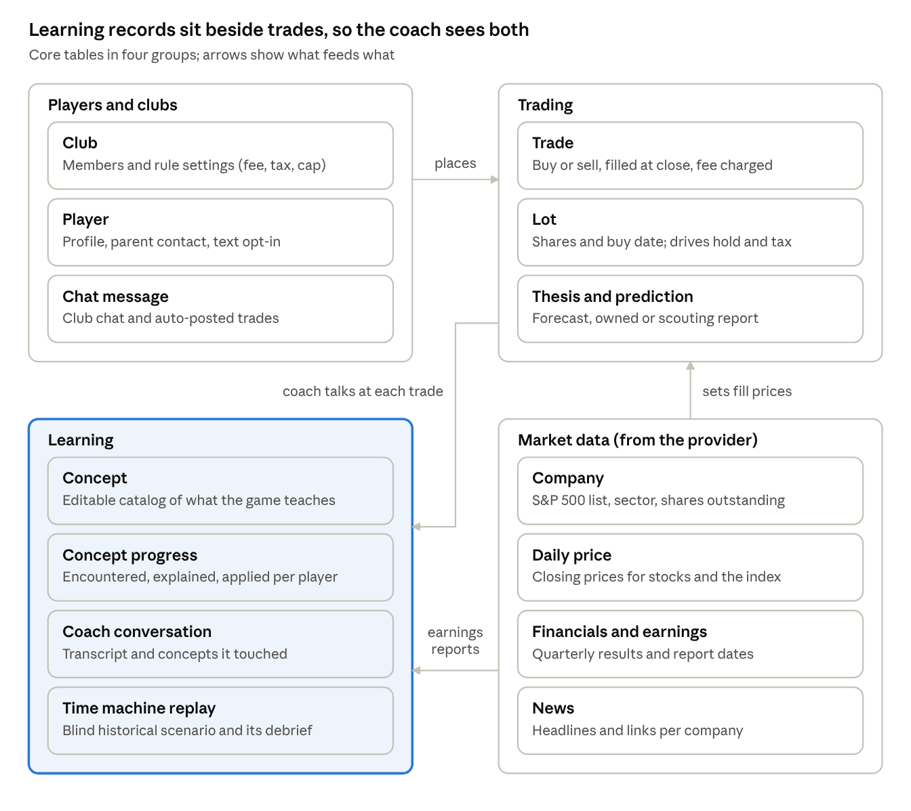

# Owners Club — Build Spec

Jeff Keltner · last updated Nov 9, 2026

This is the build-facing companion to [the product concept](concept.md). The concept doc holds the product rules and the reasoning reviewers see; this doc holds the technical decisions, the data model and anything the code needs. When the two disagree, the concept doc wins on game rules and this doc wins on implementation.

## Decision log

Every technical decision lands here with its status. Product and game-rule decisions live in the concept doc.

| Area | Decision | Why | Status |
| --- | --- | --- | --- |
| Name | Owners Club. Folder owners\_club, repository owners-club. | Signals the ownership mindset the game teaches; each friend group is its own named club. | Decided |
| Platform | A mobile-optimized web app that kids add to their home screen. No native app for the pilot. | Chat works fine in a browser, iPhones support push for home-screen web apps since iOS 16.4, and there's no app store review. Go native later only if the pilot shows kids keep coming back; the backend carries over. | Decided |
| Notifications | Text (Twilio) and email are the main channels; web push is a bonus. | Reaches kids with nothing to install. Texting needs A2P 10DLC registration (Twilio's Sole Proprietor option fits a pilot) and a parent's opt-in for each phone number. | Decided |
| Audience | Ages 13 and up, private leagues by invitation only. | Keeps the pilot outside COPPA's parental-consent rules for under-13s; reviewers also felt younger kids may be too young. | Decided |
| Open source | Public repository under the MIT license. API keys, credentials and all player data stay out of the code, in environment settings and the database. | Lets teachers and parents reuse it and reviewers suggest better teaching notes, and qualifies for Alpha Vantage's open-source and educational access. Anyone running their own copy needs their own market data license; the README will say so. Public code means access rules (each kid sees only their own league) must be right from day one. | Decided |
| Learning objectives | Stored as structured, editable records that the coach, weekly recap and progress tracker all read. | One source of truth for what the game teaches and how. See [Learning objectives store](#learning-objectives-store); the catalog itself lives in [`content/concepts.yaml`](../content/concepts.yaml). | Decided |
| Game settings | Fee, tax rates, hold period and position cap are per-league settings, with defaults from the concept doc. | Lets us tune the rules during the pilot without code changes. | Decided |
| Trade execution | Orders fill at the next market close. Portfolios and the leaderboard update once a day, after the close. | Needs only end-of-day prices (cheaper, simpler licensing) and removes any reason to watch prices during the day. One daily update is plenty for long-term play and less distracting. | Decided |
| Backend | One Next.js app in `web/` on Vercel; Neon Postgres (Vercel Marketplace) with Drizzle for schema and migrations; Better Auth for sign-in (Google and email one-time codes, no passwords); club chat by polling, no realtime layer in the pilot. Supabase (database, login, realtime and row-level security in one) was compared and declined. | The stack Deep Thoughts already runs, so the setup and its gotchas are known; open-source, self-hostable sign-in suits an MIT project; the game updates daily so realtime chat isn't worth a second stack yet. Comparison in [the build plan](build_plan.md). | Decided (2026-11-09) |
| AI model | Claude API for the coach, the weekly recap and the concept tagger: `claude-opus-5-5` for the coach and recap, `claude-haiku-5-5` for the tagger, model ids in environment variables per job. Structured output in the `CoachReply` shape; every turn stored before it's returned; a post-check regenerates any reply that recommends. Every call logs its token usage and estimated cost to an `ai_calls` table, with a weekly cost line in the monitoring email, prompt caching on the stable prefix, and a daily spend cap that falls back to the scripted coach. | Strong at Socratic questioning and plain-language writing; one vendor for all three jobs. Coaching quality is the product, so the conversations get the stronger model; the tagger is a classification call on every thesis. Jeff's condition: track the cost and compare Sonnet 5.5 on the eval set after phase 4 before settling. | Decided (2026-11-08) |
| Market data | A free stack behind our own data layer: SEC EDGAR for fundamentals, Massive's free tier for daily prices, Alpha Vantage's free tier for earnings dates, news and time-machine history. Before beta, get written display permission for prices (Alpha Vantage first; Intrinio Startup as the known-price fallback). About 5 to 30 calls a day in total. | See Market data. | Decided |
| Time machine data | Replays need about 25 years of daily prices plus historical financials for the companies in each scenario, precomputed and stored. | Confirm how far back Alpha Vantage's daily history goes. Structured financials from SEC EDGAR start around 2009, so a 2000 dot-com valuation replay needs another source or hand-entered figures. | Open |
| Feedback loop | The ✎ button files notes as GitHub issues in jkeltner/owners-club through `api/feedback.ts` on Vercel: one issue per tester per day (label `playtest-feedback`), one comment per note with a game snapshot. Testers get a random ID, never a name. Every morning a launchd job on the Mac mini runs Claude Code headless with the `review-feedback` skill: it reads each new issue against the product rules, the concept doc, earlier playtest logs and the code, posts a Recommend / Discuss / Decline comment with effort, labels the issue `reviewed`, and emails Jeff an HTML report. Nothing changes until Jeff says which recommendations to take (see `docs/feedback_review.md`). | Keeps player and reviewer feedback next to the code. One issue per tester per day keeps the count manageable while each note stays separate. The review runs on the mini from a clone in `~/Code` because launchd can't read `~/Documents`; a cloud routine would need its own GitHub token. Quiet days cost no model run. | Decided (2026-11-04) |
| App home screen | Returning players with a portfolio open on the feed; players still onboarding resume where they left off. | The feed is what changed since last time; the other tabs are a tap away. | Decided |
| Prototype hosting | The prototype is on Vercel at owners-club-alpha.vercel.app, a public static site (no password), with one serverless function that files feedback notes as GitHub issues. Every push to `main` deploys to production (repo connected 2026-10-20). | Lets outside playtesters try it from a link; the GitHub token stays on the server. Auto-deploy chosen for speed of iteration over a review step. | Decided |
| Starting position | Every player starts with $10,000 in an S&P 500 index holding. It's exempt from the 25% cap and the minimum hold, and pays the same fees and taxes as any other holding. | Removes the blank-portfolio problem for first-timers. No hold lets money move into a first pick right away; equal taxes keep the index from becoming a tax shelter. The data layer needs index prices (an S&P 500 ETF's daily close works). | Decided |
| Design iteration | Clickable prototypes of the six key screens (onboarding, coach, portfolio, sell-now, leaderboard, time machine), playtested with a few kids before the full build. | Whether kids find it fun decides whether any of the learning happens, and screens are far cheaper to change as prototypes than as code. | Proposed |
| Prototype stack | Vite + React + TypeScript in `prototype/`, building to static files. Content YAML imported at build time; fake data in `prototype/src/data/`; state in localStorage. | The brief's default. No backend, so it can be hosted on GitHub Pages and opened on a phone from a link. | Decided |
| Coach interface | One async function, `askCoach(context, input)`, returns chat bubbles, tap replies and concept marks. The prototype's version is scripted; the real one calls the Claude API with the same inputs. | Lets the live coach replace the script without touching any screen. | Proposed |
| Lesson content | Lessons live in `content/lessons.yaml`: round 1 (example and predict question) and round 3 (the coach's question, push back and wrap-up) as editable text with `{placeholders}`; round 2 is interactive and computed from game numbers, so it lives in code, one component per format. | Writers and reviewers can edit lesson wording without touching code, while the interactive parts stay testable. Round 3 runs through `askCoach` in a `lesson` mode, so the live coach can take it over. | Proposed |
| Time machine replays | Each replay is one record in `prototype/src/data/time_machine.ts`: the price series, checkpoints, allowed choices (hold, trim, sell, buy back), comparison runs and the coach's debrief lines computed from the results. The same component runs a replay on its own or as round 2 of a lesson. | Adding a replay means adding data, not a screen. In the real app the series come from stored history (see the Time machine data row). | Proposed |
| Player experience level | Asked once after joining (`new`, `some`, `lots`), stored with the player, changeable in the profile. Passed to the coach in its context; also sets where lessons start and how much the market screen explains. | One field the live coach can use the same way the script does, instead of separate flows per level. | Decided |
| New listings card | A weekly list of recent IPOs (name, ticker, date, what it does, how it makes money, one question, related S&P 500 companies). The prototype hard-codes three 2025 listings in `prototype/src/data/new_listings.ts`. | Source still open: see `docs/data_needs.md`. The plain-language fields need writing per company, so likely a weekly curated step, possibly drafted by the model and reviewed. | Open |
| Index-to-pick fee | Moving money from the index into a pick is one trade: one 0.5% fee on the amount moved, not a fee on the index sale plus another on the purchase. | Keeps the first pick simple to explain; rule recorded in the concept doc's index holding section. | Decided |
| Showdown votes | A vote is a record per player and thesis: holds or breaks, timestamped, resolved when the thesis's prediction is scored at earnings. Hidden from other players until the company reports. Counted into a per-player "calls" record for the predictions board; never read by the rank computation. | Keeps the social mechanic separate from the learning record, so a vote can never earn a rank. Resolution reuses the prediction scoring the earnings job already does. | Proposed |
| Weekly club replay | The weekly job picks one scenario per club before the recap goes out: each scenario scores against the club's positions (largest single position, share in one kind of business, weighted P/E vs. the market, members still all in the index), with a penalty for replays most of the club has already had. The pick and its one-line reason are stored per club per week; the recap compares choices. The prototype's version is `prototype/src/lib/weekly_replay.ts` over the fake club. | Same replay for everyone in a club gives the week something shared to argue about, and choosing it against the club's theses makes the time machine relevant to the game instead of a side activity. Scoring by rule, not by model, so the reason is always explainable. | Proposed |
| Scout coach mode | `askCoach` gets a `scout` mode with a focus concept in its facts. The script applies the concept to the company's numbers (one fact per concept in `prototype/src/coach/concept_facts.ts`), asks for the player's read, then hands over to the report. The live coach does the same from the concept record and the company's data. | Every concept on the Learn tab needs a path to being used, and the coach is the part that can show the concept on real numbers. Same interface as the pick conversation, so screens don't change when the live coach lands. | Proposed |
| Real build | The pilot app is built in `web/` by the phases in [the build plan](build_plan.md): data layer first (about a week), then accounts and the first 15 minutes, portfolio and board, the live coach, an adult pilot club (adults play exactly as kids would, for four to six weeks), Learn and the weekly jobs into that club, then pilot readiness and the first kids' club. Pure game logic from `prototype/src/lib/` moves over with tests; `content/` loads into the database on deploy; the prototype's screens are ported, its fake data dropped. | Starts the slow, risky pieces (market data, the price display license) before the screens the prototype already proved. The adult club finds what breaks over weeks of real play before any kid depends on it. | Decided (2026-11-09) |
| Scheduled jobs | Vercel Cron: one nightly job after the close (prices, fills, portfolios, leaderboard, earnings checks) and one weekly job (recap, club replay, new listings), each idempotent and re-runnable by hand. No queue until something needs retries. The nightly job runs at 06:00 UTC, Tuesday to Saturday (1 am Eastern in winter, 2 am in summer), so East Coast players wake up to yesterday's close. | Matches the game's once-a-day rhythm; Pro allows re-runs and earnings-day checks on any schedule. The time is forced by Massive's free plan, which serves a day's closes from midnight Eastern (measured once, on 2026-11-10: refused at 11:54 pm, served at 12:09 am), not that same evening. | Decided (2026-11-09; time moved from 9:30 pm Eastern to 6 am on 2026-11-10, then to 1 am on 2026-11-11) |
| Accounts | Anyone 13 or older can create a club and becomes its organizer; players join from an expiring invite link, sign in with Google or an email one-time code (no passwords, no phone sign-in in the pilot), and pick a name and avatar. No birthdate asked. Sign-up shows "By clicking Agree you confirm you are 13 or older and accept the Terms and Privacy Policy"; the time and the version agreed to are stored. The terms say plainly that the money is pretend and the coach is an AI. If we learn a player is under 13, the account and its data are removed. Public wording says "teens (13 and up)", not "kids". Every query is scoped to the player's club. | We can't verify that a club's creator is an adult, so the parent requirement was unenforceable (Jeff, 2026-11-12); a high school club should be able to start itself. COPPA applies to services aimed at under-13s or that know a user is under 13; we do store personal information (email, name, what players write), so the protection is the 13+ confirmation, the wording and removal on notice. Fine for a pilot; get a lawyer's read before a public sign-up page. | Decided (2026-11-08; creator and age gate revised 2026-11-12) |
| Memberships are the player | All game state (orders, lots, theses, portfolio history, comments, votes, coach conversations) belongs to a membership: one person in one club. Sign-in and concept progress (and so rank) belong to the person. A membership has a role (organizer or member) and a `plays` flag: a teacher is an organizer who doesn't play. A club can have more than one organizer. The pilot's screens assume one club per person. | A person in two clubs needs a separate portfolio in each (different start dates and settings); the first data model keyed lots, theses and portfolio history by player alone, which would have blended them. Learning is the person's. "Mirror this trade in my other club" can come later without a schema change. | Decided (2026-11-12) |
| Organizer view | Organizers who don't play see every player's holdings, trades, theses, returns and concept progress, in dollars and live. An organizer who also plays sees what any player sees. Coach conversations are never shown to anyone but the player. Players are told at joining. | A teacher or parent running a club needs to see how it's going; honesty with the coach depends on privacy. A playing organizer with the live view could copy trades, which the weekly lag exists to prevent. | Decided (2026-11-12) |
| S&P 500 member list | Wikipedia's maintained table (ticker, GICS sector and sub-industry, CIK, date added), refreshed nightly; a member that drops out is marked removed, never deleted. Our sector lens is chosen from the GICS sub-industry (`web/src/market/lens.ts`). | S&P's own list is licensed; Wikipedia tracks index changes within a day or two and carries the CIK the SEC data needs. Players may still hold a removed member. | Decided (2026-11-09) |
| EDGAR access | The XBRL frames API (`/api/xbrl/frames/<taxonomy>/<tag>/<unit>/<period>.json`): one call per concept per calendar period returns every filer's value. Nightly: the latest three quarters, the current calendar year and the two before it; backfill: twenty quarters and six years plus the current one. The current year matters because fiscal years ending June to October are filed under it. Fractional share counts are dropped (a filer tagging in millions) and fractional dollar amounts rounded. The 10-K quarter is derived as the year minus the other three quarters at read time. | A few dozen small calls a night instead of the multi-gigabyte bulk file, inside a Vercel function's limits; the SEC asks for a contact in the User-Agent and under 10 requests a second. | Decided (2026-11-09) |
| Share count fallback | Market cap uses reported shares outstanding (`dei:EntityCommonStockSharesOutstanding`); when a company has none in the frames, the latest quarter's weighted-average diluted shares (`WeightedAverageNumberOfDilutedSharesOutstanding`, new column `shares_diluted`), else trailing net income ÷ trailing diluted EPS over the same four quarters. `sharesSource` records which; `/admin` marks the last two. | Dual-class filers (META, V, MA, BRK.B, CMCSA, NKE, UPS, ACN) report shares outstanding per share class, which the frames API leaves out, so 41 members had no market cap. Both fallbacks count all classes together, which is what a market cap needs, and come from the same frames calls. Caveat: Berkshire's EPS is per Class A share. | Proposed (2026-11-10) |
| 10-K quarter derivation | Derive the missing quarter only when the three reported quarters lie inside the annual row's dates (7 days of slack for 52/53-week years), run back to back and leave one hole of 12 to 17 weeks at an edge of a twelve-month year (PepsiCo and Domino's run a 16-week fourth quarter); name it by the calendar quarter holding most of it. A number is not derived from an annual figure a thousand times smaller than its three quarters (FedEx and Medtronic file the 10-K's net income in millions without the scale). Trailing sums need four back-to-back quarters. Company-level totals count one row per CIK (`onePerCompany`). | Off-calendar fiscal years (May, April) produced wrong quarters or trailing sums over fifteen months; a missing number is better than a wrong one. Dual listings (GOOG/GOOGL, FOX/FOXA, NWS/NWSA) counted twice in the market P/E and sector bands. | Proposed (2026-11-10) |
| Quarters the frames leave out | After the frames step, companies whose trailing revenue or profit is blank get one call each to EDGAR's company facts (`/api/xbrl/companyfacts/`), and `quartersFromFacts` (`web/src/market/edgar_facts.ts`) stores what the frames missed: a quarter's own fact, or a year-to-date figure minus the quarters already known. Only 10-Q and 10-K facts are used. A second fiscal quarter that falls in the same calendar quarter is stored as `CY2026Q1b`. Where a company's fact for exactly a stored row's dates differs from the row, the fact wins; 12-week filers are re-checked every night because the frames step rewrites their rows. Full years are still subtracted at read time. | The frames hold one fact per company per calendar quarter. Costco and AutoZone run 12-week quarters, so two fiscal quarters share a frame and the row can mix one quarter's revenue with the next one's profit. Dow, Edison International and United Rentals have no second-quarter 2026 facts in the API at all, though the 10-Qs were filed; the nine-month figure in the next 10-Q recovers the quarter. Cash flow is filed year to date, so this is also the only source of quarterly free cash flow for these companies. A few dozen calls a night; all 500 would be several gigabytes. | Decided (2026-11-12) |
| Net income filed without its scale | When a row's net income is about a thousand or a million times smaller than its EPS times diluted shares, it is multiplied up before storing (`fixProxyScale`). Only annual rows under $100 million are touched, because a wrong share count can set the check off (Waters). `NetIncomeLossAvailableToCommonStockholdersBasic` is the second concept tried for net income, before `ProfitLoss`. Revenue also tries `RevenueFromContractWithCustomerIncludingAssessedTax` (Best Buy, TJX, Kraft Heinz, CrowdStrike) and `RegulatedAndUnregulatedOperatingRevenue` (utilities). | The proxy statement's pay-versus-performance table tags `NetIncomeLoss` in millions (PG&E, Medtronic, Arista, FedEx, Paychex) or thousands (Con Edison, Schwab), and when the 10-K uses another tag, the proxy's figure is the one the frame returns. That gave Con Edison a P/E of 161 and left four companies blank. Booking tags only the available-to-common concept. | Decided (2026-11-12) |
| Registrant changes | `PREDECESSOR_CIKS` in `web/src/market/edgar.ts` maps a company's current CIK to earlier ones; rows fetched for an old CIK are stored under the current one. One entry so far: ExxonMobil Holdings Corp (2115436) and Exxon Mobil Corp (34088). | Exxon's filings before the second quarter of 2026 are under the old registrant, so its history stopped at two quarters. A hand-kept list, because EDGAR doesn't link the two. | Decided (2026-11-12) |
| Index holding price | SPY's daily close stands in for the S&P 500 holding; the ticker `SPX` in the rules engine maps to it. | The S&P 500 index level isn't in the free price data; SPY tracks it within a few basis points and is what a real account would hold. | Decided (2026-11-09) |
| Real-build hosting | Vercel project `owners-club-web` in Jeff's Projects (upgraded to Pro), root `web/`, previews per branch, production from `main`. The prototype's project `owners-club` keeps serving owners-club-alpha.vercel.app until the real app replaces it, then the names swap. | Pro removes the Hobby plan's non-commercial terms and cron limits; one team keeps Jeff's projects together; testers keep a stable prototype during the build. | Decided (2026-11-09) |
| Migrations on deploy | Only a production build applies `drizzle/` migrations; preview builds skip them (`web/src/db/migrate_policy.ts`). Setting `MIGRATE_PREVIEW_DATABASE=1` in the Preview environment turns them back on, for when previews have a database of their own (a Neon branch per preview). | Vercel gives preview builds the production `DATABASE_URL`, so the EDGAR cleanup PR's migration reached Neon before it was reviewed. Previews still read and write production data at runtime; a database per preview is the full fix. | Decided (2026-11-11); database per preview: Open |
| P/E shown to players | Trailing P/E only: market cap ÷ the last four quarters of reported net income (EDGAR). No forward P/E and no analyst estimates. Above 100 the screen says "over 100" (`peLabel` and `PE_SHOWN_UP_TO` in `web/src/lib/format.ts`) with a plain line that profit over the last year was very small compared with the price, and the coach asks whether the company is expensive or something unusual hit its profit. Stored and computed values keep the real number; `/admin` shows both. A second number beside it (price to free cash flow or operating margin) is Proposed, for the company card in phase 2. | Jeff, 2026-11-12: the very high P/Es are probably right but misleading. Forward P/E would smooth one-off charges, but the expensive companies stay expensive on it, analyst estimates leave out stock-based pay (so software looks cheaper than its filings say), a forecast is harder to explain than last year's profit, and the free data has no full-year estimates. On 2026-11-11's closes 22 of 454 companies with a P/E were above 100. | Decided (2026-11-12); second number: Proposed |
| Buyable universe | Players can buy from the S&P 500 only. | A founder note had proposed any NYSE or Nasdaq stock above a size and volume floor. Decided against on 2026-11-02 after a parent reviewer called the absence of penny stocks the game's biggest differentiator; widening would also need a floor, clean fundamentals for small companies and a new answer for why recent IPOs aren't buyable. The member list is the only universe the data layer has to cover. | Decided |

## Data model

The database needs three kinds of records the app owns (players, trades and learning) plus a cache of market data from the provider.

Two details matter most for the game rules. Each purchase is stored as its own lot with a buy date, which is what makes the hold period, the 6-month tax threshold and losses offsetting gains computable. And each coach conversation links to both the trade or thesis that prompted it and the concepts it touched, so the tracker can always show its evidence.

A scouting report is a thesis with no position attached, so it's scored at earnings the same way. Ranks (Shareholder, Owner, Board Member, Chair) and the Bell are computed from these records rather than stored separately.

## Learning objectives store

The concept list is data, not code. Each concept is an editable record, and every AI part of the app reads from the same records, so adding a concept or changing how it's taught changes the coach, the recap and the tracker at once.

**Each concept record holds:**

| Field | What it holds | Example: P/E ratio |
| --- | --- | --- |
| Slug | A stable id | pe-ratio |
| Level | 1 to 3 | 1 |
| Prerequisites | Concepts a player should have applied first | market-cap, revenue-vs-earnings |
| Learned by | Explanation or experience | Explanation |
| Kid explanation | Two or three sentences a 13-year-old understands | How many dollars investors pay today for each $1 the company earns in a year. |
| Teaching notes | How we want it presented: analogies to use, things to avoid | Use a lemonade-stand example. Never call a high P/E "bad"; ask what growth would justify it. |
| Misconceptions | Wrong ideas to watch for | "A low P/E means the stock is cheap." |
| Trigger events | Game events that mark it as encountered | Buying a stock with a P/E over 50 |
| Coach questions | Questions the coach can ask around it | What would earnings need to do for this price to make sense? |
| Check questions | Multiple-choice questions with answers | Two companies trade at 30x earnings; one grows 10% a year, one 40%. Which is the better deal? |
| Status | Draft or active | Active |

**Each player's progress** is a separate record per player and concept: when it was encountered, explained and applied, with a link to the evidence (the coach conversation, thesis or game event).

**How the AI parts use it:**

- **Coach:** every conversation gets a one-line summary of each active concept, the full record for the one to three concepts this moment touches (picked by trigger events and the player's progress), and the player's progress record. So it knows what's covered, what's next, and how we want each idea taught.
- **Weekly recap:** picks one concept that most of the league hasn't encountered and works it into the recap.
- **Concept tagger:** after each coach conversation or new thesis, a small model call marks which concepts were encountered, explained or applied, and saves the evidence.

**No search index needed yet.** At 10 to 50 concepts, the whole catalog fits easily in the coach's context, so the app selects concepts by rules rather than by similarity search. That's simpler to build and easier to predict. A retrieval layer becomes worthwhile only if the library grows to hundreds of concepts or long teaching materials.

**Editing:** start with the catalog as a structured file in the code repository that loads into the database on each deploy, so Claude Code can edit it and changes are versioned. Add an admin page later if reviewers want to edit concepts directly.

**Ranks.** A player's rank is computed from their progress records: Owner when every active Level 1 concept is applied, Board Member for Level 2, Chair for Level 3 plus a full season of scored predictions. The thresholds live in the same catalog file, so they can be tuned without code changes.

**Quizzes teach; theses prove.** A passed check question sets a concept to explained only. The tagger sets applied only from a thesis or scouting report, so players can speed-run learning but can't quiz their way up the ranks.

**Time machine scenarios** are records in the same catalog:

| Field | What it holds |
| --- | --- |
| Concepts | Which concepts the replay teaches |
| Real setup | The actual tickers, weights and date range |
| Blind description | What the player sees, with no company name or date |
| Checkpoints | The moments the player chooses to hold, trim or sell |
| Reveal | The company, the dates and what actually happened |
| Debrief questions | What the coach asks afterward |

Each scenario's prices are precomputed and stored, so a replay never calls the market data provider.

## Market data

The data itself is cheap; the right to show it to kids in an app is the hard part. Every affordable plan I found is licensed for personal or internal use only. Showing the data to other people needs a separate display agreement, priced by quote. FMP says this applies even to a free, private prototype with a handful of users.

**What the game needs:** the S&P 500 list; daily closing prices for each stock and the index; quarterly financials (revenue, net income, EPS, shares outstanding) to compute P/E, margins and growth; an earnings calendar with actual results; and company news headlines. The full running list, with what each number is used for, is in [data needs](data_needs.md).

| Provider | What it covers | Individual price | Showing data to app users |
| --- | --- | --- | --- |
| [Alpha Vantage](https://www.alphavantage.co/support/#support) | Prices, fundamentals (including P/E and earnings vs. estimates), earnings calendar, news | Free at 25 requests a day; [premium](https://www.alphavantage.co/premium/) from $49.99/mo; "unlimited API requests for verified open-source or educational projects" | [Terms](https://www.alphavantage.co/terms_of_service/) license personal, non-commercial use, and count letting anyone else access the data as commercial. The educational offer lifts request limits; it doesn't say it grants display rights |
| [Financial Modeling Prep (FMP)](https://site.financialmodelingprep.com/pricing-plans) | Prices, fundamentals, earnings calendar and news in one API | $19/mo (Starter) to $49/mo (Premium), billed annually | Needs a separate Data Display and Licensing Agreement, priced by quote ([FMP guidance](https://site.financialmodelingprep.com/insights/platform/can-you-use-fmp-data-in-a-public-app-website-or-client-dashboard)) |
| [EODHD](https://eodhd.com/pricing) | Prices, fundamentals, earnings calendar, news | $49.99/mo (fundamentals) or $83.33/mo (all-in-one), billed annually | Cheapest [commercial plan](https://eodhd.com/commercial-pricing) is $399/mo and internal-use only; display by custom quote |
| [Tiingo](https://www.tiingo.com/about/pricing) | Prices and news; fundamentals as an add-on | $30/mo; business internal use $50/mo | Internal use only; redistribution through sales |
| [Massive (formerly Polygon)](https://massive.com/pricing) | The strongest price data; financials as an add-on | $29 to $199/mo | [Business plan](https://massive.com/business) $2,499/mo, financials add-on $699/mo; startups can get 25%+ off the first year |
| [SEC EDGAR](https://www.sec.gov/search-filings/edgar-application-programming-interfaces) | Official financials straight from company filings | Free, no key needed | Public government data. No prices, news or estimates, and the raw data needs cleanup |

**Decision:** start on a free stack, with every source behind our own data layer so any piece can be swapped.

| Data | Source | Calls | Notes |
| --- | --- | --- | --- |
| Fundamentals (revenue, earnings, EPS, shares) | [SEC EDGAR](https://www.sec.gov/search-filings/edgar-application-programming-interfaces) bulk download | 0: one nightly file covers every company | Public filings, so showing them to players needs no license. Structured data starts around 2009. |
| Daily closing prices, all US stocks | [Massive free tier](https://massive.com/docs/rest/stocks/aggregates/daily-market-summary) whole-market daily summary | 1 a day | Free tier keeps 2 years of history and is licensed for individual use. |
| Earnings dates and results, news headlines | Alpha Vantage free tier | A handful a day | 25 requests a day. News is shown as headlines that link out. |
| Long price history for time-machine scenarios | Alpha Vantage full daily history | A few dozen, once per scenario | Fetched once and stored with each scenario. |

**How the data layer works:**

- **A thin adapter per data type.** Prices, financials, earnings and news each have one module, so swapping a source changes one module and nothing else.
- **The app never calls a provider directly.** A nightly job pulls everything into our own tables, and every screen, the coach and the leaderboard read only from those tables.
- **We compute the numbers ourselves.** P/E, margins and growth come from raw financials in our code, so they don't depend on any provider's definitions.
- **Development stays inside the free terms,** which allow personal use for research and testing.

**What still needs a license before beta: daily closing prices.** Stock exchanges own price data, so displaying it to players is the one piece the free tiers don't cover. Fundamentals come from public filings and news links out, so neither needs a display license. Before any kid sees the app, ask Alpha Vantage for written permission under its educational access. If they say no, [Intrinio's Startup plan](https://intrinio.com/pricing) includes display rights at a published price ($333/mo for the first 6 months, then $666 and $999), and only the price adapter changes.

I'm not a lawyer; the display terms need to be confirmed in writing with whichever provider we choose.

## Open technical questions

- [ ] Before beta: will Alpha Vantage confirm in writing that its educational access covers showing daily prices to players? If not, is Intrinio Startup worth it, or is there a cheaper licensed price source?
- [ ] Sector yardsticks: which can we compute from SEC filings (free cash flow, margins, return on equity, price-to-book, Rule of 40), and which company-reported numbers (same-store sales, subscribers, customer retention) do we skip for the alpha or source elsewhere? Each company also needs a sector tag to pick its lens.
- [ ] Dividends: credit them to portfolios as cash and measure against the S&P 500's total return, including dividends. Needs dividend history from the price source.
- [ ] Does an AI recap that summarizes licensed news count as displaying that news?
- [ ] Who edits the concept catalog: only through Claude Code, or do reviewers need an admin page?
- [x] How do accounts work? Settled 2026-11-12: anyone 13 or older creates a club, players join by invite link with Google or an email code, memberships carry the portfolio (Accounts, Memberships and Organizer view rows in the decision log). Phone sign-in deferred past the pilot.
- [ ] How long do we keep kids' chat messages and coach conversations?
- [ ] The parent nugget (concept doc open question 7): if a kid opts in, where does the weekly one-liner go (a parent's phone number or email on the kid's profile, or a parent account), and does the weekly recap job produce it?

## Sources

- [OneSignal: web push for iOS](https://documentation.onesignal.com/docs/web-push-for-ios)
- [Twilio: A2P 10DLC registration](https://www.twilio.com/docs/messaging/compliance/a2p-10dlc)
- Provider pricing pages are linked in the Market data table.
