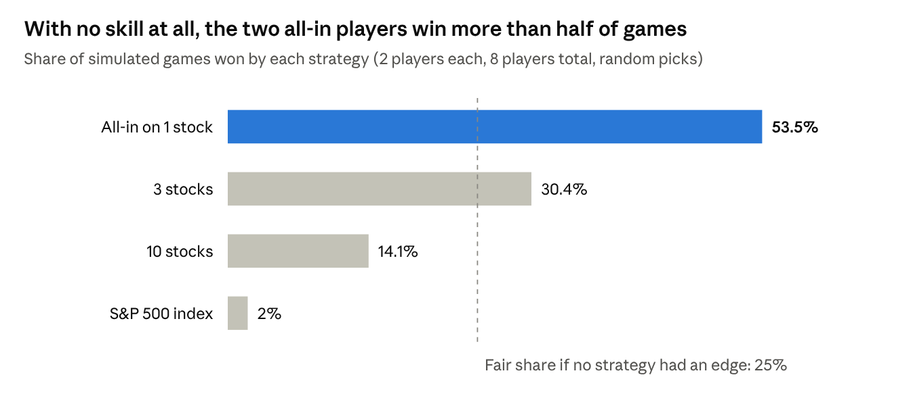
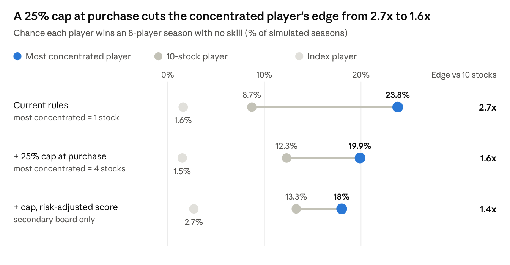

# Owners Club: A Stock-Picking Game for Kids

Jeff Keltner · last updated Oct 18, 2026 · companion: [build spec](build_spec.md)

## Summary

This is a stock-picking game for kids and their friends that rewards understanding businesses, not betting on prices. Players manage a virtual portfolio over a school year, with basic fundamentals data and an AI coach that stress-tests their reasoning before each trade.

The core bet is that the learning comes from playing, not from winning. So the design spends its effort on making each trade a thinking exercise, and makes short-term gambling visibly expensive rather than banning it.

The plan is to start with a small pilot league of friends' kids, ages 13 and up.

**What I'd like from you:** your gut reaction, the part you think is wrong, and whether your own kids would play it. Comments directly on the doc are ideal. The open questions at the end are where I'm least sure.

## What changed since the first draft

This version folds in feedback from a first reviewer who works in wealth management, plus simulations of how the game's rules change behavior.

- **A name: Owners Club.** Each friend group is its own named club, and the name signals the ownership mindset the game teaches.
- **Learning objectives come first.** A defined list of concepts now drives the mechanics, and the app tracks which concepts each player has encountered.
- **Ranks earned by learning, not returns:** Shareholder, Owner, Board Member and Chair.
- **Ways to level up without trading,** including scouting reports and blind "time machine" replays of real market history.
- **Sector yardsticks:** each stock page shows the metrics that matter for that kind of company, since P/E doesn't fit banks, young software companies or biotechs.
- **Diversification is a rule:** no purchase can exceed 25% of the portfolio.
- **Trading fees are a percentage of the trade, not a flat amount.** A flat fee made a 10-stock portfolio pay 10 times what a one-stock portfolio paid.
- **Taxes are tougher and closer to real rates:** 40% on gains held under 6 months, 20% after. Losses offset gains.
- **The leaderboard shows after-tax value**, as if everything were sold today.
- **Competition built into the club:** a rotating title for the leader and an Owner of the Year trophy.
- **Social features borrowed from fantasy sports:** club chat, a weekly AI recap, and news on companies you own. A draft, playoffs, weekly head-to-head matchups and cash stakes were considered and dropped.
- **A guided first 15 minutes:** every player starts fully in the S&P 500 index and makes one guided first pick, starting from the companies they're curious about.
- **A plan to iterate on design with kids**, using clickable prototypes and playtests before the full build.
- **The pilot audience is ages 13 and up.**

## The problem

The tools for running a game already exist; the incentives in them are wrong. Investopedia, MarketWatch and Wall Street Survivor all support private games with set start and end dates and starting cash. What none of them do is reward the thing we actually want kids to learn.

A standard game ranks players by highest return. That rewards concentration and volatility, not judgment. In a simulated 8-player game where nobody has any skill, the players who bet everything on one stock win most of the time:

*Monte Carlo simulation, 200,000 games · each stock 35% annual volatility, 0.3 correlation between stocks · same result over 3-month and 1-year games*

Kids figure this out fast, and the lesson they take away is "swing for the fences." A longer game doesn't fix it; the results were nearly identical at 3 months and a year. Better data screens don't fix it either. The fix has to be in how the game keeps score and what it asks of players.

## Design principles

Eight principles drive every decision below. When a feature question comes up, these are the tiebreakers.

1. **The learning comes from playing, not winning.** Engagement matters more than the leaderboard. Each trade and each earnings report is the lesson.
2. **Start from what kids should learn.** A defined list of concepts comes first; every mechanic exists to teach one of them.
3. **Reward reasoning, not just outcomes.** Players write down why they're buying and what they expect to happen, and that gets checked against reality.
4. **The index is the baseline.** Every player is measured against the S&P 500, because beating it is the actual hard thing.
5. **Make short-term behavior expensive, not forbidden.** Fees, taxes and hold periods let kids feel the cost of churning without banning it.
6. **The AI coaches; it never judges or recommends.** It asks questions and shows numbers. It never blocks a trade or says a stock is good or bad.
7. **Show the shape of risk; don't lecture.** Put concentration and valuation next to returns, and let kids draw the conclusion.
8. **Write for a smart 14-year-old with no investing background.** Every term is explained where it appears (tap it for a plain definition, what's normal and an example), every number comes with something to compare it to (a P/E next to a typical company's), and the game only points at numbers the player can actually see. This applies to the coach's prompts as much as to the screens.

## Learning objectives

The game should leave every player understanding the concepts below. Half of them can't be explained, only experienced: nobody learns concentration risk from a definition; they learn it when a 50% position drops 30%.

| Level | Concept | How the game teaches it | Learned by |
| --- | --- | --- | --- |
| 1 | Market cap vs. share price | Coach explains at the first trade | Explanation |
| 1 | Revenue vs. earnings; P/E ratio | Coach explains at the first trade | Explanation |
| 1 | The index as a benchmark | Leaderboard scored against the S&P 500 | Experience |
| 2 | Diversification and concentration risk | 25% purchase cap, drift chart, hold-period prompts | Experience |
| 2 | Correlation: four tech stocks aren't diversified | Sector mix on the portfolio and club views | Experience |
| 2 | Profit margins | Fundamentals screen; coach questions | Explanation |
| 2 | Free cash flow: the cash a business actually generates, vs. reported earnings | Fundamentals screen; coach compares earnings with cash | Explanation |
| 2 | Dividends and dividend yield | Dividends credited to the portfolio as cash | Experience |
| 2 | Debt and balance-sheet risk | Net debt on the stock page; coach questions | Explanation |
| 2 | Costs and taxes reduce returns | "Sell now vs. wait" screen; fees and taxes paid to date | Experience |
| 2 | Luck vs. skill (process vs. outcome) | Earnings-day follow-up on predictions | Experience |
| 3 | Different businesses, different yardsticks | Sector lens on each stock page; coach flags the wrong metric | Explanation |
| 3 | PEG ratio: paying for growth | Unlocked once P/E is understood | Explanation |
| 3 | Price-to-book, for banks and insurers | Sector lens | Explanation |
| 3 | Return on equity and return on invested capital | Fundamentals screen; coach questions | Explanation |
| 3 | Rule of 40 for software: growth plus cash margin | Sector lens | Explanation |
| 3 | Earnings growth vs. multiple expansion | Breakdown of each winner's gain | Experience |
| 3 | Peak-cycle earnings: why a low P/E can be a trap for chipmakers and homebuilders | Time machine replay | Experience |
| 3 | "It's already priced in" | Coach questions on popular stocks; time machine | Explanation |

**Different businesses, different yardsticks.** A reviewer in wealth management pointed out that the right metric depends on how a company makes money: P/E means little for a bank, a young software company or a biotech with no profits yet. So each stock page gets a small sector lens showing the two or three numbers that matter most for that kind of company, plus one to be careful with. The coach uses the same lens, for example when a player justifies a biotech purchase with its P/E.

| Kind of company | Look at first | Then | Be careful with |
| --- | --- | --- | --- |
| Software | Revenue growth plus free-cash-flow margin (Rule of 40) | Gross margin, customer retention | P/E for young, unprofitable companies |
| Chipmakers | Free cash flow across the boom-and-bust cycle | Gross margin, return on invested capital | P/E at the peak of a boom |
| Retailers and restaurants | Same-store sales | Operating margin, inventory | Price-to-sales without margins |
| Consumer brands | Organic sales growth | Margins, cash conversion | PEG without asking whether the brand lasts |
| Banks | Return on equity, price-to-tangible-book | Net interest margin, loan quality | Free cash flow and EV/EBITDA |
| Media and streaming | Free cash flow | Subscriber growth and churn | P/E while spending heavily on content |
| Drugmakers and biotech | Drug pipeline and patents; cash runway for young biotechs | Free cash flow | P/E for companies with no profits yet |
| Energy producers | Free-cash-flow yield | Breakeven oil price, debt | P/E at peak oil prices |

The full version, covering 19 sectors, is in [the sector metrics reference](sector_metrics_reference.md). One limit for the alpha: some yardsticks (same-store sales, subscriber counts, customer retention) come from company presentations rather than standard financial filings, so the app will compute what it can from the filings and let the coach explain the rest.

**Tracking what each player has learned.** For each player and concept, the app records three states:

- **Encountered:** the concept came up in their play (a big drop in a concentrated position, a tax bill on an early sale).
- **Explained:** the coach walked them through it, or they answered a check question correctly.
- **Applied:** they used it unprompted in a thesis or scouting report.

The coach uses this record in two ways. It unlocks Level 3 concepts once a player has applied the Level 1 and 2 concepts they build on. And when a concept hasn't come up naturally, the coach creates the moment with a hypothetical: "If Nvidia fell 30% tomorrow, what would happen to your portfolio?" Players and parents can see a simple progress view of which concepts each player has covered.

**Ranks: earning your way into the club.** Players move up through four ranks based on what they've learned, not on returns. This gives kids status to chase that doesn't depend on a lucky stock.

| Rank | Earned by |
| --- | --- |
| Shareholder | Joining and making a first purchase with a written thesis |
| Owner | Applying the Level 1 concepts |
| Board Member | Applying the Level 2 concepts |
| Chair | Mastering Level 3, plus a full season of prediction track record |

**Leveling up without trading.** Kids who want to move faster can, without trading more. The rule: a quiz can teach a concept, but you level up by using it. Passing a check question marks a concept as explained; applied still means using it in a written thesis. Chair needs a season of predictions, so the top rank always takes time.

- **Scouting reports.** Write a thesis and a prediction on any company without buying it. It's scored at earnings like a real position, so the fastest way to level up is to analyze more companies, not to trade more.
- **Coach office hours.** Ask the coach to teach any concept, then answer its check questions.
- **Lessons.** Each concept has a 3-minute lesson in three rounds: an everyday example with a question to predict the answer, the same idea tried on a real company in the game, then a judgment question where the coach pushes back once. Finishing a lesson marks the concept explained, never applied.
- **Time machine.** Replay a real stretch of market history in a few minutes (see below).

**The Learn tab** holds all of this in one place: the player's rank and the one concrete step to the next one, a suggested lesson (a concept they've run into but haven't learned yet), scouting reports, the time machine replays, and every concept grouped by rank. Level 3 concepts are visible from the start so curious players can peek, but their lessons open only once the concepts they build on have been used in a thesis. The top of the tab is the player's path: the four ranks, and the concepts they need for the next one with each concept's progress. The first visit adds a short card explaining how leveling up works, which the player dismisses. Wherever a concept is underlined in the game, its explanation links to the concept's lesson.

Lessons come in six formats, because not every concept works as a conversation:

| Format | Round 2 is… | Good for |
| --- | --- | --- |
| Talk it through | A coach conversation using a real company's numbers | P/E, market cap, debt, free cash flow |
| Time machine | A blind replay of history | Diversification, correlation, peak-cycle earnings |
| Sort it | Put four companies in order, or match each to its metric | Profit margins, sector yardsticks |
| What if | Sliders that change one number while the result updates | Costs and taxes, dividends, PEG |
| Run it 100 times | A simulation the player starts and watches | Luck vs. skill |
| Spot the flaw | Find the weak spot in a friend's made-up thesis | "Already priced in" |

**The time machine.** Some concepts can only be learned by living through them, and real time is too slow. The time machine replays real historical episodes in a few minutes. Replays are blind: the player sees the situation ("You own a social media company. It's 50% of your portfolio.") but not the company or the date, decides to hold, trim or sell at a few checkpoints, and only then sees what it was and what happened. Without the blinding, a kid who recognizes March 2020 already knows the market recovered, and the lesson is gone.

Each episode is tied to a concept:

| Episode (revealed afterward) | Concept it teaches |
| --- | --- |
| A single big-tech stock through 2022 | Concentration risk |
| Several tech stocks together in 2022 | Correlation: four tech stocks aren't diversified |
| The 2020 COVID crash and recovery | Panic selling and time horizon |
| A dot-com favorite trading at 100+ times earnings in 2000 | "It's already priced in" and valuation |
| The index vs. stock picking over a decade | The index as a benchmark |
| A memory-chip maker at a P/E of 4, at the top of a boom (2018) | Peak-cycle earnings: when a low P/E is a trap |

Finishing a replay marks its concept as encountered, and the coach's debrief can mark it explained. That lets the coach create the moment for any concept a player hasn't hit naturally.

## How the game works

Players join a private league, get $10,000 in virtual cash, and build a portfolio they hold for a full school year. The rules below are each there for a specific reason.

| Rule | How it works | Why |
| --- | --- | --- |
| Private leagues | A parent creates a league and invites players, ages 13 and up. | Kids play with people they know; the social part is what keeps them playing. |
| Join anytime | New players can join mid-season. Everyone starts with $10,000 in an S&P 500 index fund (see The first 15 minutes). | It will take time to get friends on board. Trailing-return scoring (below) keeps late joiners comparable. |
| Curated stock list | Players can buy from the S&P 500, not any ticker. | Keeps out penny stocks and meme names, and guarantees clean fundamentals data for everything buyable. |
| Basic fundamentals | Each stock shows price history, revenue, earnings, EPS, P/E, margins and growth. | Enough to reason about a business; far short of a Bloomberg terminal. |
| Position cap | No purchase can be more than 25% of the portfolio's value. Winners can grow past 25% afterward. | Guarantees at least four holdings, while keeping the lesson of winners drifting into concentration. |
| Minimum hold | Each purchase is locked for 3 months. | Every decision lives long enough to be judged, including through at least one earnings report. Per-position locks mean free cash can always be used. |
| Trading fee | 0.5% of each trade's value, shown before the player confirms. | Churning costs returns, and the cost is the same whether you hold 4 positions or 12. |
| Capital gains tax | 40% on gains held under 6 months, 20% on gains held longer. Losses offset gains. | Close to real top-bracket rates, and the 20-point gap rewards patience. The real-world threshold is 12 months; 6 matches the game's timescale. |
| Shared theses | A player's reasoning is visible to the league when they buy. Comments attach to the thesis. Tapping a player on the leaderboard shows their portfolio: each holding's share of the whole (never dollars), as of last Friday's close, with the thesis it was bought with. | The social activity becomes arguing about businesses, not prices. |
| Delayed positions | Holdings are revealed with a lag (weekly), not in real time. | Prevents everyone from copying whoever is in first place. |

All of these settings start at the values above and can be changed per league.

The cost of selling early is shown at the moment of decision, which is when it teaches the most. For a $200 gain on a position bought five months ago:

> **Sell now:** you keep $1,120 (40% tax on the gain)  
> **Wait 23 more days:** you keep $1,160 (20% tax)

Each portfolio page shows three numbers side by side: total value, unrealized tax owed, and after-tax value if everything were sold today. It also shows a running total of fees and taxes paid this season.

## The first 15 minutes

A first-timer shouldn't face a blank $10,000. That's intimidating, and it pushes kids to spend the cash on whatever's famous just to get started. Many 13- and 14-year-olds are excited about a company or two but have no idea how to build a portfolio, so onboarding starts from that excitement and turns it into the first lesson.

1. **Everyone starts fully invested in the S&P 500.** A new player's $10,000 begins in an index fund: "You already own a small piece of 500 companies." That teaches the benchmark in the first minute, and every player starts level with the market. Each pick is then a deliberate bet against the index ("I'm moving $2,000 out of the market and into Nvidia because..."), and a kid who makes one great pick and leaves the rest in the index is playing well.
2. **Start from curiosity.** The first screen asks what companies they use, love or think will be huge. Kids can type a name or browse themes like AI, space, sports and gaming, food, or stuff I use every day; each theme shows a handful of companies from the game's list. That's curation, not recommendation: the coach still never says what to buy.
3. **Whatever they name becomes the first lesson.** For Nvidia, the coach runs a light version of its usual conversation ("Everyone knows AI is huge, so what's already in the price?"). For SpaceX, the lesson is that it isn't in the S&P 500: public vs. private companies, IPOs, and why you can't buy everything. Then: "Which public companies would do well if space takes off?" Finding the companies that sell the picks and shovels is a real investing skill.
4. **One guided first pick.** Up to the 25% cap, with a short written thesis and one prediction. It earns the Shareholder rank and sets up the reason to come back: "Nvidia reports in 23 days. We'll see if you were right."
5. **Friends' theses as examples.** A player who joins through a friend's invite sees why others bought what they did. Seeing a friend's reasoning is the easiest way to learn what a thesis looks like.
6. **Optional: a 3-minute time machine as the tutorial.** "Pick one of these three companies. It's 2019. Fast-forward." It shows the stakes before any real decisions, and it marks a few concepts as encountered.

**How the index holding works.** The index is a holding like any other, with two exemptions: it doesn't count toward the 25% cap, and it has no minimum hold, so money can move into a pick at any time. It pays the same fees and taxes as everything else, with one simplification: moving money from the index into a pick counts as a single trade, so the 0.5% fee is charged once on the amount moved, not on both the index sale and the purchase. Exempting it from taxes would turn it into a tax shelter that beats the board for free. It's also unnecessary, because the leaderboard already shows after-tax value as if everything were sold today, so moving money from the index into a pick costs nothing extra on the board.

## The AI coach

The coach is the heart of the product: before every trade, it has a short conversation that turns a hunch into a testable thesis. It never approves or blocks a trade, and it never offers its own opinion of a stock. If it could block trades, kids would learn to say the magic words to get past it.

Its core move is asking "what do you have to believe?" using real numbers:

> **Player:** I want to buy Nvidia because AI is huge!
>
> **Coach:** Agreed, AI is huge. Everyone else knows that too, so it's probably in the price already. Right now investors are paying about X times earnings. What would Nvidia's earnings need to do over the next few years for that to be a good deal? Do you think that's likely?

The conversation ends with a short written thesis and one concrete prediction (for example, "data center revenue grows over 50% next quarter"). Both are saved and shared with the league.

Each position then follows the same cycle:

1. **Before buying:** two or three questions on the biggest hole in the thesis, then a recorded thesis and prediction.
2. **At each earnings report:** the coach compares the prediction to what happened. "You said 50%. It grew 30%. The stock went up anyway. Were you right or lucky?"
3. **When the hold period ends:** the coach shows how the position has changed (see Portfolio insights) and asks the player to hold, trim or sell. No answer is implied.
4. **At each later earnings report:** the check-in repeats for as long as the position is held.

Separating good reasoning from good outcomes is the most important lesson in investing, and almost nothing teaches it to kids.

**Teaching new concepts.** The coach is also how players move through the learning objectives. Occasionally it ends a conversation with a short multiple-choice check question; a correct answer marks the concept as explained (only a thesis marks it applied), and can unlock the next one. For example, once a player is comfortable with P/E, the coach introduces the PEG ratio: "Two companies both trade at 30 times earnings. One grows 10% a year, the other 40%. Which is the better deal?" Every coach conversation updates the player's concept tracker.

**Keeping friction from killing play.** A five-minute interrogation before every trade will make kids quit. So the coach:

- asks two or three questions at most, focused on the single weakest point;
- starts gentle and gets deeper as a player gains experience, which works as a game mechanic in itself;
- accepts voice input, since kids will talk through an idea they'd never type out;
- also raises portfolio-level questions at decision points ("70% of your money now depends on one industry; is that what you meant?").

## Scoring and leaderboard

The main board ranks players by their 6-month trailing return minus the S&P 500's return over the same period. Returns are measured on after-tax value, as if every position were sold today, so the tax cost of recent trades always shows. The board runs cumulatively across the school year rather than resetting each round, which rewards consistency over one lucky stretch.

**Returns are shown over 3, 6, 9 and 12 months, never annualized.** This is how Morningstar reports fund performance, so kids learn the real convention. Trailing windows also make late joiners comparable: everyone is measured against the index over the same period. Annualizing would break this: a player up 8% in their first month would show roughly +150% a year and top the board.

**Risk sits next to return on every row.** This is what keeps the leaderboard from teaching "bet everything on one stock":

| Player | 6-mo return vs S&P | Months playing | Holdings | Largest position | Weighted P/E |
| --- | --- | --- | --- | --- | --- |
| Player A | +18% | 7 | 1 | 100% | 85 |
| Player B | +4% | 8 | 8 | 22% | 24 |
| Player C | −1% | 6 | 12 | 15% | 19 |

*Illustrative example.* Anyone can see that Player A won by betting everything on one expensive stock. That conversation is worth more than any written lesson.

The main board stays simple on purpose. Secondary boards sit beside it, each highlighting a different kind of success:

- **Rookie board:** players with under 6 months of history are ranked on 3-month returns until they qualify, so newcomers have something to aim for right away.
- **Long-term board:** 12-month returns, for players who have been in the game a full year.
- **Risk-adjusted board:** return per unit of volatility. Too abstract for the main board, but a good conversation starter about what "winning" means.
- **Predictions board:** ranks players on how often their thesis predictions came true. Over a full year, this is the board that comes closest to measuring skill rather than luck.

An honest caveat for reviewers: no rule set makes the index player win among eight kids, because whoever takes more risk tops the board more often. The goal is narrower: concentration shouldn't be the obvious winning strategy. The stress tests in the next section show the rules get there.

## Stress-testing the rules

The rules were tested by simulating seasons in which no player has any skill. Three findings shaped the current design.

**1. The 25% purchase cap does most of the diversification work.** It makes four stocks the most concentrated portfolio allowed, which sharply narrows the edge of the riskiest player:

*Monte Carlo simulation, 40,000 one-year seasons of daily returns · 8 players: 2 most concentrated allowed, 2 with 3–6 stocks, 2 with 10 stocks, 2 index · each stock 35% annual volatility, 0.3 correlation*

Scoring on risk-adjusted return narrows the gap a little further, but it's too abstract for a main leaderboard, so it lives on a secondary board.

**2. A flat trading fee would have pushed kids toward concentration.** It charges the same for a small position as a large one, so diversified portfolios pay far more. With quarterly turnover on a $10,000 portfolio:

| Positions held | Flat $25 fee, cost per year | 0.5% fee, cost per year |
| --- | --- | --- |
| 1 | 2% | 4% |
| 4 | 8% | 4% |
| 10 | 20% | 4% |

A percentage fee costs the same however a portfolio is split, so it penalizes trading frequency, not diversification.

**3. Taxes change how often kids trade, not who wins.** A gains tax shrinks every portfolio's gains in proportion, so rankings stay the same. Two design details matter more than the rate. Losses must offset gains: taxing each position separately raised a diversified player's average tax from 5.5% to 7.6% of starting value, the same as a one-stock player's. And there's no season-end tax event; the after-tax value is shown continuously, so kids don't stop trading halfway through the season to avoid the higher rate.

## Portfolio insights

The app shows each player how their portfolio has changed shape over time, because most real investors who end up dangerously concentrated never chose it; their winners grew into it. Tech employees with most of their wealth in company stock are the classic example.

**Drift over time.** The centerpiece of the portfolio page is a chart of each holding's share of the portfolio over time, with the portfolio's weighted P/E plotted on top. A big winner pushes up both its own share and the average valuation, so the portfolio is bigger and riskier at the same time. Players may choose not to diversify, but they see the case for it.

**What drove each gain.** Each winner's return is split into what the business did and what investors became willing to pay:

> **Nvidia: +60% since you bought**  
> Earnings grew: +25%  
> Investors paying more per dollar of earnings: +28%

The second part is the fragile one; it can reverse without the business doing anything wrong. This one breakdown teaches valuation better than any definition of P/E.

**Prompts at decision points, not constant warnings.** When a position's hold period ends, the coach summarizes the change: "This position is now 45% of your portfolio, up from 20% when you bought. Most of the gain came from a higher price per dollar of earnings. Hold, trim or sell?"

**The league's combined portfolio.** A league-level view shows aggregate concentration, sector mix and weighted P/E versus the market. For example: "Together, this league is 60% tech, at twice the market's P/E." It shows the group its collective blind spot and opens a natural conversation about diversification.

## Staying engaged

The game borrows fantasy sports' social mechanics and deliberately leaves out its money and short-term mechanics. Fantasy is hugely popular with this age group, and research on why people play puts keeping up friendships near the top (cited by 45% of players) and competition well behind (23%). But for teens it has also become a pipeline to gambling: in a 2025 industry survey of 13–20-year-old fantasy players, 72% called daily fantasy "an easy way to make money," and 74% expect to bet on sports once they're old enough.

**What the game borrows:**

- **Club chat.** Built in, with new theses and trades posted into it automatically. This is where the trash talk happens. The fantasy app Sleeper grew by turning each league into a group chat with a game attached.
- **A weekly AI recap.** A short, lightly roasting summary of the league's week that also slips in one concept: "Alex's portfolio P/E just hit 60. Here's what that means."
- **News on companies you own.** Alerts on earnings, big moves and major news for each player's holdings, by text or email, so there's a reason to open the app that's about the business.
- **Earnings-day events.** When a company several players hold reports, the league sees whose predictions came true.

**Competition built into the club:**

- **Each friend group is its own named club**, like "Pasadena Owners Club." The rivalry with your friends is the point.
- **The Bell.** A title held by whoever leads the main 6-month board, named for the bell that opens the stock market each day. The weekly recap announces who holds it, who took it and who's closing in. Because it follows the 6-month board, it changes hands slowly. (It was called the Gavel until the first playtest review, which found that felt more legal than financial.)
- **Owner of the Year.** A real trophy for the season's leader.
- **Club vs. club, later.** Once there are several clubs, rank them on their combined portfolio against the S&P 500: competition between groups, teamwork within them, and a reward for a well-diversified club.

Ranks come from learning and the Bell comes from performance, so kids can chase both, and neither depends only on luck. The tagline makes it explicit: **Owners Club: beat the market, then beat your friends.**

**What it leaves out, and why:**

| Fantasy mechanic | Why it's out |
| --- | --- |
| Draft with exclusive picks | Rewards racing to claim a company, not reasoning about it. |
| Weekly head-to-head matchups | Puts the focus on one week's price moves. |
| End-of-season playoffs | Concentrates the stakes in a short window at the end. |
| Entry fees, cash prizes, daily contests | The gambling pipeline this game is meant to counter. |

## Making it fun: design and playtesting

The rules and the learning model only work if kids want to open the app, so the interactive pieces and visual design get as much iteration as the game mechanics. The plan is to prototype and playtest the screens that carry the experience before building the full app, then keep iterating once the pilot is live.

**The screens that matter most:**

- The first 15 minutes: starting in the index, the curiosity screen and the first pick
- The coach conversation, including voice input
- The portfolio page, with the drift chart and the after-tax view
- The "sell now vs. wait" screen
- The leaderboard, the Bell and the weekly recap
- The time machine replay

**How we iterate:** clickable prototypes of these screens, tested with a few kids before the full build; short playtest sessions watching where they get stuck or bored; and, once the pilot is live, an in-app feedback button that files ideas and complaints straight into the project's issue tracker for regular review. The test for every screen: would a 14-year-old choose to open this on a random Tuesday?

## Open questions

Two questions from the first draft are now settled: the game starts as a small pilot that could grow into a broader educational tool, and the pilot is for ages 13 and up. These are the questions still open. Opinions on any of them are especially welcome.

1. **What does this get wrong about how real investing works?** If you pick stocks for a living, what would you change so kids learn habits that hold up in the real world?
2. **What's missing from the learning objectives?** Which concepts would you add, cut or move to a different level? In particular, which sector yardsticks are worth teaching a 13-year-old, and which are too much?
3. **Are the cost settings right now?** A 0.5% trading fee, a 40% / 20% tax split at 6 months, a 3-month minimum hold and a 25% cap at purchase. Too harsh, too soft, or the wrong tools?
4. **How should predictions be scored?** The current plan is to have players pick from a menu of measurable metrics (revenue growth, earnings per share, margins) and commit to a number, so grading is objective. Is that enough, or too restrictive?
5. **Is a brief coach conversation enough to teach anything?** Two or three questions keeps the game fun. Does it achieve the learning goal?
6. **What would make your kid open it on a random Tuesday?** Company news, the weekly recap and the club chat are the current answers. What else?

## Sources

- [New FSGA research on fantasy sports and sports betting participation (July 2025)](https://thefsga.org/new-fsga-research-highlights-industry-stability-and-next-generation-growth-in-fantasy-sports-and-sports-betting)
- [Churchyard et al., revised model for involvement in fantasy football (2024)](https://repository.uwl.ac.uk/id/eprint/13044/1/Churchyard_The%20revised%20model%20for%20initial%20and%20continued%20involvement%20in%20fantasy%20football_1-s2.0-S1875952124002854-main.pdf)
- [TechCrunch on Sleeper's chat-first fantasy app](https://techcrunch.com/?p=1868752)
- Simulations of win odds, fees and taxes: run for this doc; method in each chart's caption.
